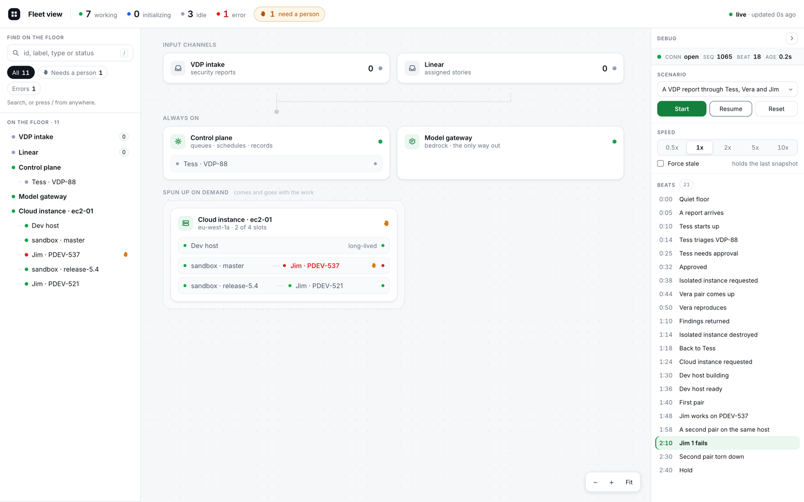
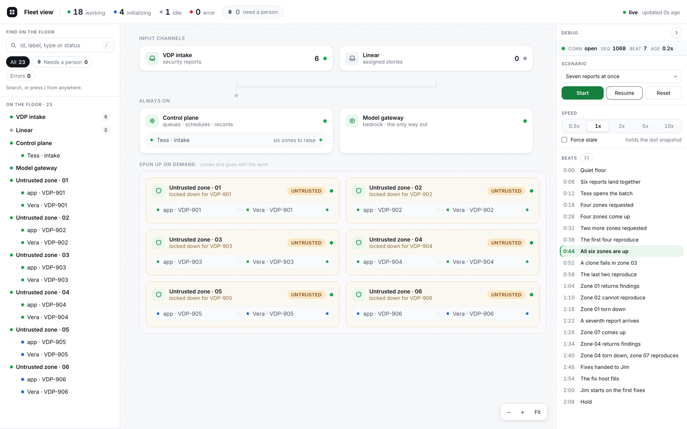
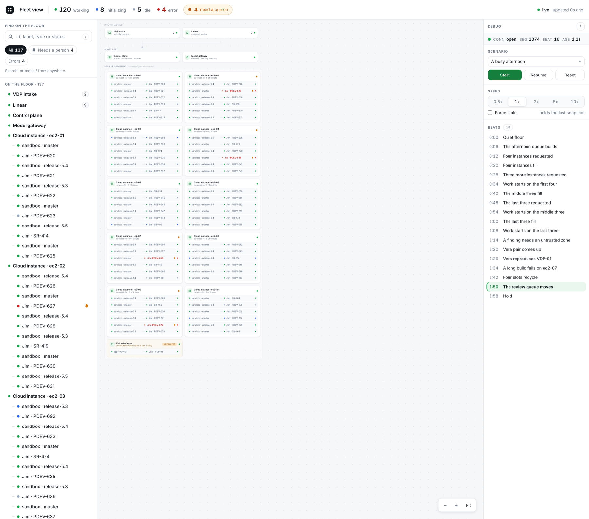
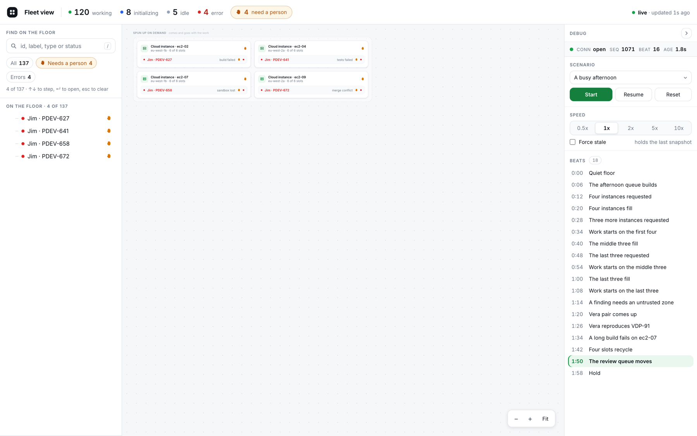
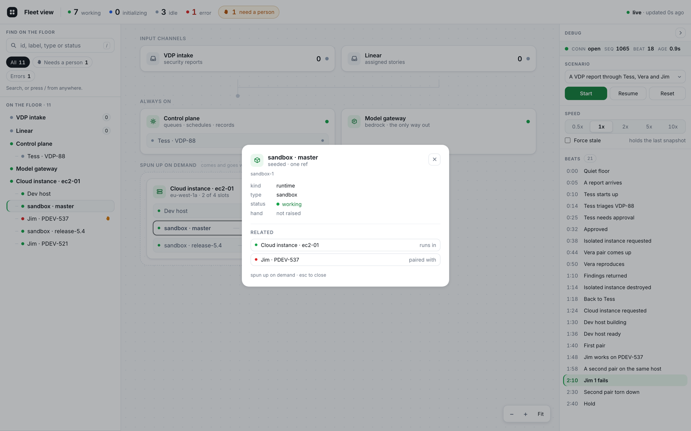

# agent-fleet-view

A local proof of concept for a live, read-only view of agent infrastructure: what is running
right now, across everything, with a click through to the tool that manages it.



## What it is

- **A discovery surface, not a lookup surface.** It answers "what is going on today", not "where is PDEV-524".
- **Read-only.** It manages nothing; every link goes out to the tool that does.
- **Identifiers, never content.** Ids, labels, statuses, counts. No log lines, prompts, tool output or report text.
- **A state, not a story.** One current state at a time; nothing travels along a line.
- **One level.** Everything is drawn at once, so finding something is filtering rather than navigating.

## The visual grammar

| Rule | Detail |
| --- | --- |
| Four statuses | `initializing` blue, `working` green, `idle` grey, `error` red |
| The raised hand | A person is needed, whatever the reason — a fault raises one, a wait raises one |
| A container shows two marks | Its own status, and a binary "anything inside needs a person" |
| Three bands | Input channels, always on, spun up on demand — derived from `(kind, persistent)`, never declared |
| Pairs | A sandbox and its agent are two components on one row, tethered, stacking in spawn order |
| Freed slots | Stay empty. Nothing below a torn-down pair moves |
| Untrusted zones | Drawn like any other infrastructure, labelled `UNTRUSTED`, dashed and amber |
| Freshness | Last snapshot age, top right: green under 20s, amber to 60s, red beyond |



Six zones at once, and every stage visible at the same moment: zone 07 empty and locking down,
zone 06 claiming its pair, zones 03–05 reproducing, zone 02 stopped with its hand up. One Tess
raised all of them, one at a time.

## Scenarios

The simulator is the only producer. Pick one in the debug panel, or click any beat to jump.

| Id | Title | Beats | Ends with | Exercises |
| --- | --- | --- | --- | --- |
| `scenario-01` | A VDP report through Tess, Vera and Jim | 21 | 11 entities | One story end to end: triage, an isolated zone created and destroyed, pairs stacking, a freed slot |
| `scenario-02` | A busy afternoon | 18 | 137 entities | Density: 10 instances × 6 pairs, 4 faults, slot recycling |
| `scenario-03` | Seven reports, one at a time | 20 | 23 entities | A serial bottleneck: Tess triages one report at a time, but reproducing outlasts triaging, so six zones pile up behind her |



## Finding things

Search by id, label, type or status; `/` focuses from anywhere. The **Needs a person** pill narrows
the floor to what is waiting, keeping each row inside the container it belongs to.



Clicking any row opens a detail dialog: identifiers, status, badges, links out, and the things it
runs in, is paired with, or contains.



## Running it

```bash
nvm use            # Node 24; anything >= 22 works
pnpm install
pnpm dev           # server on 8787, web on 5173
pnpm check         # build, lint, test — the gate
pnpm fixtures      # regenerate fixtures/ from the scenario data
```

`http://localhost:5173?source=fixtures` replays the golden snapshots instead, for working without
the server.

## Layout

```text
packages/schema      the contract: entities, wire, scenario, the three scenarios
packages/simulator   pure scenario engine — reproduces the fixtures exactly
packages/layout      pure positioning primitives; not currently used by the floor
apps/server          ws server on 8787/stream, tick loop, the command set
apps/web/src/theme   colour and radius tokens
apps/web/src/store   hand-rolled store on useSyncExternalStore, memoised selectors
apps/web/src/net     live ws client, fixture client
apps/web/src/floor   the floor: bands, cards, pair rows, pan and zoom
apps/web/src/chrome  summary strip, search, list, detail dialog, freshness
apps/web/src/debug   the debug panel
fixtures/            golden snapshots per scenario + manifest.json
```

## How it is held together

- **The contract is `packages/schema`.** Closed vocabularies for kind, status and glyph; a producer picks one and never adds to the set.
- **The renderer knows no domain.** It draws containers, rows, pairs, statuses and links. "Jim", "Vera" and "sandbox" are producer wording.
- **Golden fixtures are the test oracle.** Every scenario replays byte for byte against `fixtures/`, so a change to the data is visible in a diff.
- **Bands fall out of the entity**, so a producer never has to know what its neighbours are.
- **Motion is a second channel, not decoration.** Arrivals, teardowns and colour changes ease so a change is noticed; nothing lasts longer than one tick.

Stack: pnpm workspaces, Node ≥ 22, TypeScript 6 strict, Zod 4, React 19, Vite 8, `ws`, Motion 14,
Biome 2.5, Vitest 4. The floor is plain DOM — PixiJS was planned and dropped. 240 tests across 14 files.

| Change | Animated by | Timing |
| --- | --- | --- |
| Status colour | CSS transition | 350ms |
| A card or row arriving | Motion variants | 320ms |
| A card or row torn down | Motion `AnimatePresence` | 220ms |
| Cards repacking after a teardown | Motion `layout="position"` | 300ms |
| A raised hand | CSS keyframe | a 14% breath every 3.2s |
| Counts, the freshness dot | CSS keyframe | 240ms, 620ms |

`prefers-reduced-motion` turns all of it off — Motion through `MotionConfig reducedMotion="user"`,
CSS through a media query.

## What this POC owes the Linear project

Nothing. If the agreed work on Standalone Agent Orchestration settles on different data structures,
this changes to match them. The contract here binds nothing there.

See [docs/PLAN.md](docs/PLAN.md) for the design decisions and the task split that built it.
